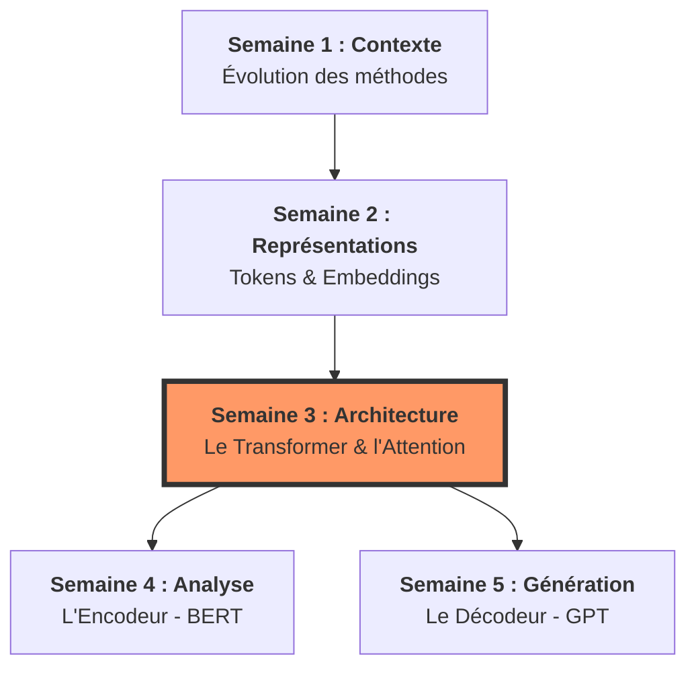

# Chapitre 1 : Fondements des modèles de langage

## Représentations et architectures (semaines 1 à 5)

Ce chapitre présente les notions et les méthodes décrites ci-dessous. Les activités permettent de les appliquer et d’en examiner les limites.

## Organisation du chapitre

* **Semaine 1 : Repères historiques** : méthodes de comptage, représentations distribuées et architectures séquentielles.
* **Semaine 2 : Tokenisation et embeddings** : segmentation du texte et représentation vectorielle des tokens.
* **Semaine 3 : Architecture Transformer** : attention, encodage positionnel et organisation des blocs.
* **Semaine 4 : Modèles de représentation** : BERT, classification et évaluation.
* **Semaine 5 : Modèles de génération** : GPT, décodage et limites des réponses générées.

## Progression des apprentissages

## Liens entre les notions

1. La tokenisation définit les unités d’entrée ; les embeddings leur associent des vecteurs.
2. L’attention combine ces vecteurs en tenant compte du contexte, tandis que l’encodage positionnel apporte l’information d’ordre.
3. Les architectures BERT et GPT illustrent des objectifs et des modes d’utilisation distincts du Transformer.

> [!IMPORTANT]
> Justifiez les choix techniques à partir des objectifs de la tâche et des résultats d’évaluation.
