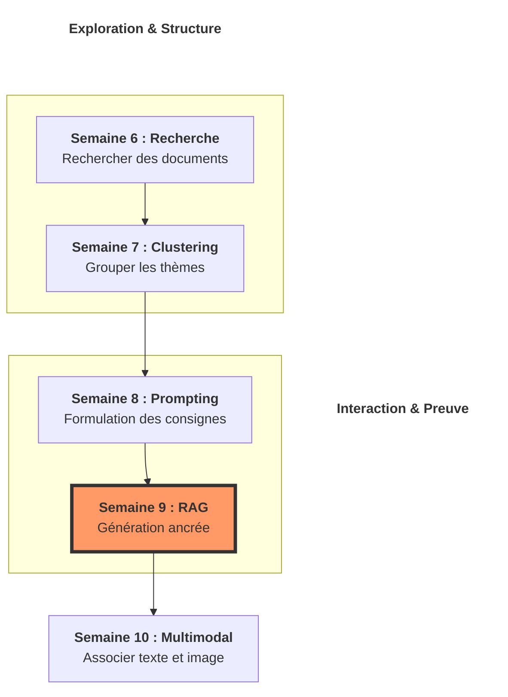

# Chapitre 2 : Applications des modèles de langage

## Recherche, génération et multimodalité (semaines 6 à 10)

Ce chapitre présente les notions et les méthodes décrites ci-dessous. Les activités permettent de les appliquer et d’en examiner les limites.

## Organisation du chapitre

* **Semaine 6 : Recherche sémantique** : représentations des documents, mesures de similarité et indexation.
* **Semaine 7 : Regroupement thématique** : réduction de dimension, clustering et BERTopic.
* **Semaine 8 : Formulation des consignes** : exemples, décomposition des tâches et contrôle des sorties.
* **Semaine 9 : RAG** : recherche documentaire, génération augmentée et évaluation.
* **Semaine 10 : Multimodalité** : représentations conjointes du texte et des images.

## Progression des apprentissages

## Liens entre les notions

1. Les représentations vectorielles servent à la recherche documentaire et au regroupement thématique.
2. La formulation des consignes définit la tâche ; le RAG ajoute des informations récupérées dans les sources.
3. Les modèles multimodaux étendent l’analyse aux relations entre des données de types différents.

> [!IMPORTANT]
> Justifiez les choix techniques à partir des objectifs de la tâche et des résultats d’évaluation.
