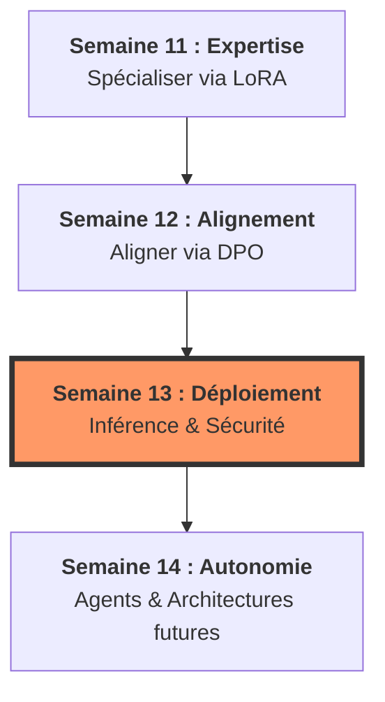

# Chapitre 3 : Ingénierie des modèles de langage

## Adaptation, déploiement et évaluation (semaines 11 à 14)

Ce chapitre présente les notions et les méthodes décrites ci-dessous. Les activités permettent de les appliquer et d’en examiner les limites.

## Organisation du chapitre

* **Semaine 11 : Adaptation** : fine-tuning supervisé, LoRA et quantification.
* **Semaine 12 : Alignement** : données de préférence, RLHF, DPO et évaluation.
* **Semaine 13 : Déploiement** : optimisation de l’inférence, sécurité et surveillance.
* **Semaine 14 : Synthèse et perspectives** : agents et architectures alternatives.

## Progression des apprentissages

## Liens entre les notions

1. L’adaptation supervisée et l’apprentissage par préférences répondent à des objectifs complémentaires.
2. Le déploiement exige de mesurer la qualité, les ressources nécessaires et les risques du système.
3. Les agents associent un modèle à des outils et à une procédure d’exécution dont les limites doivent être définies.

> [!IMPORTANT]
> Justifiez les choix techniques à partir des objectifs de la tâche et des résultats d’évaluation.
